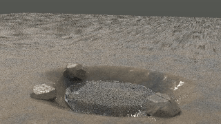
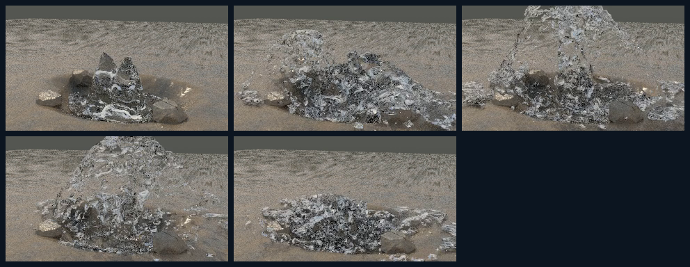
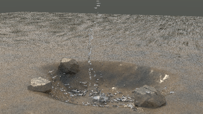
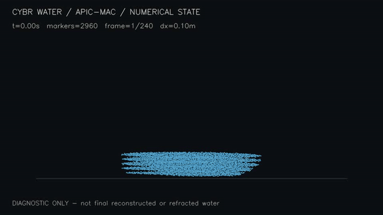

# CYBR WATER Native

Native C++ waterbending studies: an APIC/MAC liquid solver, anisotropic surface reconstruction, and native CPU path-traced / deterministic-preview rendering. The choreography is driven by body acceleration fields, not animated water meshes or direct particle placement.

This repository preserves the **open-boundary splash repair** alongside the earlier retained-trick take, a coherent coarse baseline, and failed intermediate experiments. The latest delivery repairs the earlier invisible lateral walls and reduces coarse-marker bead scale, while explicitly documenting the remaining numerical and rendering limits.

## Latest: open-boundary splash repair


The [original ten-second movie](open-splash/delivery/CYBR_WATERBENDING_OPEN_SPLASH_10S.mp4) is 960×540, 240 distinct decoded frames at 24 fps. It is a native deterministic direct-light/Whitted preview, **not converged global illumination**, image generation, or a particle diagnostic.


The source uses a uniform 3 cm grid, 1 cm primary markers, open lateral boundaries, coherent fragment classification, and flow-derived secondary visual parcels. The supplied 241-state records retain 439,737 primary markers and 0.43973699889 m³, with zero recorded primary outflow and zero markers within two grid cells of a lateral exit. Guidance ends at 8.55 s. Finer equal-volume primary spheres still represent about 12.4 mm numerical droplets, not physically validated atomization.

**At 9 s the domain is explicitly enlarged.** The packaged snapshots preserve primary positions, velocities, volumes and IDs exactly, but reconstruct APIC affine gradients and reset pressure warm start. This is not a bitwise continuation or a full energy-conservation claim.


See [complete source, dependencies, reproduction commands, sample restoration and limitations](open-splash/README.md). The complete latest engine and test set is isolated in `open-splash/`; earlier revisions are not silently overwritten. Its Python reproduction driver creates a new output tree, compiles the supplied C++17/OpenMP source, simulates the two stages, reconstructs 240 frames and verifies the encoded movie. Several GB of RAM and disk are needed. No project code was executed for this repository preparation.

## Earlier retained-trick take: historical wall audit


The [earlier full movie](media/retained-trick-10s.mp4) is also 960×540, ten seconds at 24 fps. It restored the gather/split/cross/sweep/ring sequence after the failed transport experiment, but used a 4.5 cm grid and 38,027 coarse markers. Its [splash audit](retained-trick/SPLASH_AUDIT.md) identified invisible closed side walls and repeated approximately 2.79 cm primary spheres. That source and audit are preserved unchanged as historical evidence. Their defects are not attributed to the newer open-boundary take, and the newer take is not claimed to solve all splash physics.

See [earlier source and caveats](retained-trick/README.md).

## Baseline preview



Ten-second preview from the prior saved 32-spp native export, reduced to 12 fps for the GIF. It is not the latest transport result. The full [32-spp movie](media/baseline-32spp.mp4) is 320×180, 24 fps, 240 frames. The sample count is the saved export's label, not something inferred from the MP4.



The source delivery itself includes the noisier [4-spp movie](media/baseline-4spp.mp4) and [4-spp contact sheet](media/baseline-4spp-contact.png). That delivery records 241 solver states, including t=0, and 240 rendered frames. The rendering helper retains its original 4-spp defaults. These renders show the current limitations rather than a finished VFX result.

## What's here

- [open-splash](open-splash): latest complete source/test set, reproduction driver, losslessly packaged sample states, handoff evidence, frame records and native media.
- [retained-trick](retained-trick): earlier complete source/test set, reproduction scripts, seven sample states, frame records, and historical splash audit.
- [engine/src](engine/src): baseline solver, procedural scene definitions, native mesher and tracer, and static-scene exporter.
- [scripts/render_batch.py](scripts/render_batch.py): baseline frame-to-video helper, with its machine-specific path made repository-relative.
- [experiments/geometry](experiments/geometry): preceding piecewise-guide experiment, three native diagnostic frames, and failure record.
- [experiments/transport](experiments/transport): earlier failed controller patch, particle-state diagnostic renderer, and failed native-surface status.
- [experiments/reconstruction](experiments/reconstruction): earlier thin-sheet/reference meshing-profile checkpoint, preserved as an optional source variant rather than silently merged into the baseline.
- [evidence](evidence): saved simulation metadata and logs. These are historical run evidence, not test results from this repository's publication review.
- [media](media): real saved renders and reduced-frame-rate GIFs derived from them. No generated illustration stands in for a simulation result.

No previous repository history, compiled executables, or full binary simulation caches are included. The retained-trick revision contains seven sample states and static review inputs. The open-splash revision adds five representative states and the exact pre-transfer state; six large snapshots use lossless parts. Regenerate the full take to rerender every frame.

## Baseline requirements

The native pipeline uses a C++17 compiler with OpenMP, GNU Make, and the C++ standard library. The recorded source delivery was built on Linux with g++. No GPU, external C++ library, model download, or texture pack is required by the packaged source.

Optional video helpers use Python 3, NumPy, and OpenCV with a working MP4 writer. FFmpeg is useful for converting PPM renders and MPEG-4 helper output into PNG/H.264. Python versions were not pinned in the delivery; [requirements-render.txt](requirements-render.txt) lists only the imports actually used.

Linux is the documented target. macOS/Windows builds have not been verified. In particular, a compiler without OpenMP support cannot use the default flags unchanged.

## Build and simulate the baseline

Run from the repository root:

```sh
make -C engine -j4
engine/build/gallery_sim \
  --scene waterbending_trick --dx .14 --particles-per-axis 2 \
  --apic --duration 10 --fps 24 --threads 4 \
  --pressure-iterations 65 --no-whitewater --out cache
engine/build/gallery_export --scene waterbending_trick --out solids.mesh
```

The first command builds `gallery_sim`, `surface`, `trace`, and `gallery_export`. `cache` is regenerated locally, including states and a compatible checkpoint. The archive contained only cache metadata, not the frame binaries needed for rendering. The simulator writes 241 states for t=0 through t=10 at 24 Hz; the movie uses frames 0 through 239.

The upstream subset's Makefile advertised unrelated targets whose sources were absent. The earlier `engine/Makefile` intentionally includes only those four complete targets and does not offer its missing solver test suite. The separately packaged `retained-trick/CYBR_WATER_VFX/` and latest `open-splash/engine/` contain complete source/test sets; use their own documented runners rather than mixing revision binaries.

## Render one frame

After simulation and static-scene export:

```sh
engine/build/surface --in cache/frame_000072.bin --out current.mesh \
  --threads 4 --surface-scale 1 --support 2.4 --smooth 0
engine/build/trace --water current.mesh --solids solids.mesh \
  --out current_render --width 320 --height 180 --spp 4 --bounces 8 \
  --threads 4 --camera 1.45,1.85,3.55 --target 0,.83,0 \
  --fov 29 --aperture 0 --environment neutral
ffmpeg -i current_render.ppm -frames:v 1 current_render.png
```

These flags are present in the inspected source and reproduce the settings used by the delivered baseline helper. Increase `--spp` to reduce sampling noise; that does not repair the underlying fluid choreography or thin-sheet resolution.

## Render the ten-second baseline

```sh
python3 -m venv .venv
. .venv/bin/activate
python3 -m pip install -r requirements-render.txt
python3 scripts/render_batch.py 0 240
ffmpeg -i batch_000_240.mp4 -c:v libx264 -pix_fmt yuv420p baseline.mp4
```

The range end is exclusive. The helper reconstructs each saved fluid state and invokes the native tracer; it does not interpolate missing frames. It overwrites `current.mesh` and `current_render.*`, so do not run batches concurrently in the same working tree. A full render can be much slower than the coarse simulation.

The tracer's built-in `engine/build/trace --self-test` remains available. It has not been run for this publication review. Historical solver/tracer check output belongs to the earlier reconstruction checkpoint and is clearly labeled there.

## Development status

### Baseline: pipeline complete, visual target unmet

The guide phases are gather, split, helix, whip, ring, and force fade/collapse. The dx=0.14 m grid is coarse, whitewater is disabled, and the persistent inlets continue into the intended collapse. Thin separated ribbons and a stable ring are not reliably maintained. The baseline is a solver/rendering prototype, not photorealistic or physically validated waterbending.

### Geometry experiment: failed visual acceptance

The guide uses closest-point projections on line segments, stronger/wider attraction and flow, and removes permanent inlets. Its saved validation records 241 states at dx=0.08 m, with selected 16-spp renders at 2, 5, and 7 seconds. The elevated ribbon/ring shape is lost near the midpoint. See [experiment notes](experiments/geometry/README.md).



### Earlier transport experiment: solver completes, native surface fails



The animation is a reduced 12-fps view of the [full 960×540 particle diagnostic](media/transport-diagnostic.mp4), not reconstructed or refracted water. The saved run reached ten seconds at dx=0.10 m. Its verification record reports 240 diagnostic states, 1,026–8,835 markers, and **native surface volume-solver failure at t=5 seconds**. There is no completed native beauty movie for this earlier revision. It is superseded by the separately documented retained-trick revision, not silently repaired in place. See [source, reproduction steps, and caveats](experiments/transport/README.md).

### Reconstruction checkpoint: experimental profile, not thin-sheet physics

The earlier mesher offers `--profile thin-sheet` and `--profile reference`. These are geometric parameter presets, not adaptive resolution or a physical film-preservation model. Its low-rate [20-frame movie](media/reconstruction-2fps.mp4) samples ten simulated seconds at 2 fps. The separate [64-spp detail still](media/reconstruction-detail.png) is not representative of that 4-spp movie. See [checkpoint notes](experiments/reconstruction/README.md).

## Verification and limitations

For this publication, source was statically inspected, local documentation links checked, JSON/Python syntax checked, historical and latest audit claims checked against source/data, and all six source videos strictly decoded. Media pixels were visually reviewed. The native project was **not compiled, simulated, or rerendered during this review**, so no new runtime pass is claimed. Existing run logs and assertions describe the delivered checkpoints only.

The source snapshot has no release version or pinned toolchain. Bitwise reproduction across compilers, platforms, OpenMP schedules, or video codecs is not promised. Original native checkpoints are ABI/configuration sensitive. Full multiphase water/air behavior, physically resolved thin films, reference-quality choreography, and a complete production gallery are outside the demonstrated scope.

## License

No project license was supplied with the reviewed source bundles. This publication adds no license grant.
