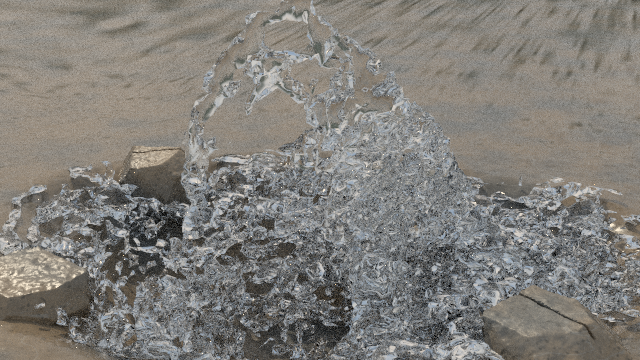

# Native meshing-profile checkpoint

This earlier checkpoint preserves an alternative `surface.cpp`. It adds `--profile thin-sheet` (supportScale=2.65, smoothing=0, surfaceScale=0.65) and `--profile reference` (3.0, 2, 0.85). These are geometric presets, not a validated thin-film solver.

The [movie](../../media/reconstruction-2fps.mp4) contains 20 frames sampled every 0.5 simulated seconds from a ten-second APIC/MAC run, at 384×216, 2 fps, 4 spp and 5 bounces. The original notes record dx=0.065 m and 8-Hz source sampling. The curl degrades with time; this does not meet the visual target.



That 640×360 still is a separate 64-spp, 12-bounce render from the selected final dynamic mesh, not a representative frame of the low-spp movie. No completed higher-resolution film is claimed.

To inspect this mesher without altering the baseline:

```sh
mkdir -p runs/reconstruction/src
cp engine/Makefile runs/reconstruction/Makefile
cp engine/src/* runs/reconstruction/src/
cp experiments/reconstruction/surface.cpp runs/reconstruction/src/surface.cpp
make -C runs/reconstruction build/surface
```

Run those commands from the repository root. The compile was not repeated for publication. The checkpoint's original full engine and complete cache are not bundled in this subdirectory; this is a source variant plus historical media, not a claim to reproduce the exact older movie from the baseline scene.

[Saved checks](evidence/checks_final.log) reported passing solver and tracer tests in the original environment. The solver-test source was not included in the smaller bundles, so the earlier baseline Makefile does not expose a misleading `make checks` target. The latest retained-trick revision has its own separate test source and target. [Completion metadata](evidence/complete.json) belongs to that older run, not to either transport revision.
