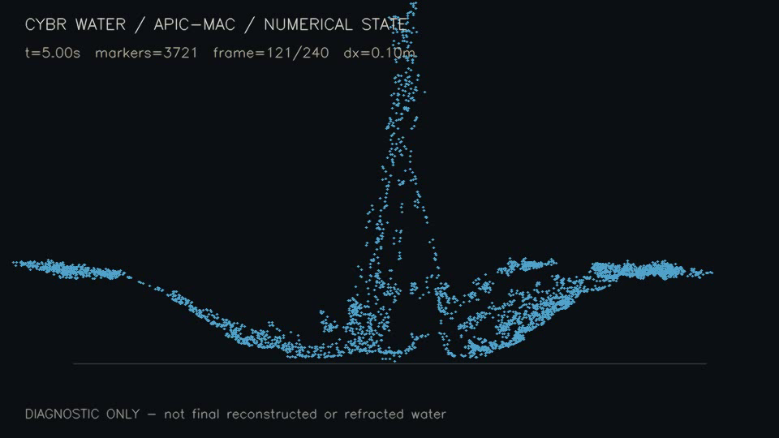

# Earlier failed transport controller experiment

Status: **numerical run complete; visual target failed; native reconstruction failed**. This is the earlier revision. The later [retained-trick source](../../retained-trick/README.md) completes a different native surface movie but retains documented splash defects.

The `gallery_scenes.hpp` variant steers fluid with a bounded acceleration field, local guide capture, and a root pump while keeping the common APIC/MAC solver. It does not directly animate mesh geometry. The saved run has no permanent scene inlets. Sustained ribbons/ring were not achieved.

The [verification record](evidence/DIAGNOSTIC_VERIFICATION.json) explicitly says native surface reconstruction failed its volume solver at 5 seconds and no final native beauty movie was produced. The [ten-second video](../../media/transport-diagnostic.mp4) is an orthographic particle-state visualization. It must not be described as a native water surface or path-traced film.



## Isolated reconstruction of the experiment setup

From the repository root, these commands combine the inspected shared baseline files with the delivered header. They are supported by the source interfaces and saved dx/fps/pressure settings, but have not been executed during this publication review:

```sh
mkdir -p runs/transport/src
cp engine/Makefile runs/transport/Makefile
cp engine/src/* runs/transport/src/
cp experiments/transport/gallery_scenes.hpp runs/transport/src/gallery_scenes.hpp
make -C runs/transport -j4
runs/transport/build/gallery_sim \
  --scene waterbending_trick --dx .10 --particles-per-axis 2 \
  --apic --duration 10 --fps 24 --threads 4 \
  --pressure-iterations 160 --no-whitewater --out runs/transport/cache
cp experiments/transport/render_solver_diagnostic.py runs/transport/
python3 runs/transport/render_solver_diagnostic.py
```

Install the optional root Python requirements first. The diagnostic helper reads 240 binary states, starting at frame 0, from a `cache/` directory beside itself and writes a movie plus verification JSON there. It contains a hard-coded historical native-surface-failure status; rerunning that helper is not a meshing test and does not newly establish that status. Keep any new verification record separately identified rather than treating it as a fresh test.

Saved simulation metadata and split/resumed logs are in [evidence/transport](../../evidence/transport). The completed state at ten seconds records 8,737 markers and volume-ledger error around -3.40e-11 m³. Numerical volume bookkeeping does not show that the intended shape survived. Full caches are not bundled; regenerate them before using the helper. No experimental changes have been silently merged into the baseline.
