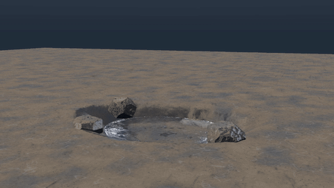
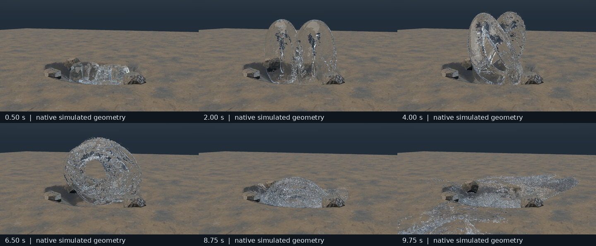
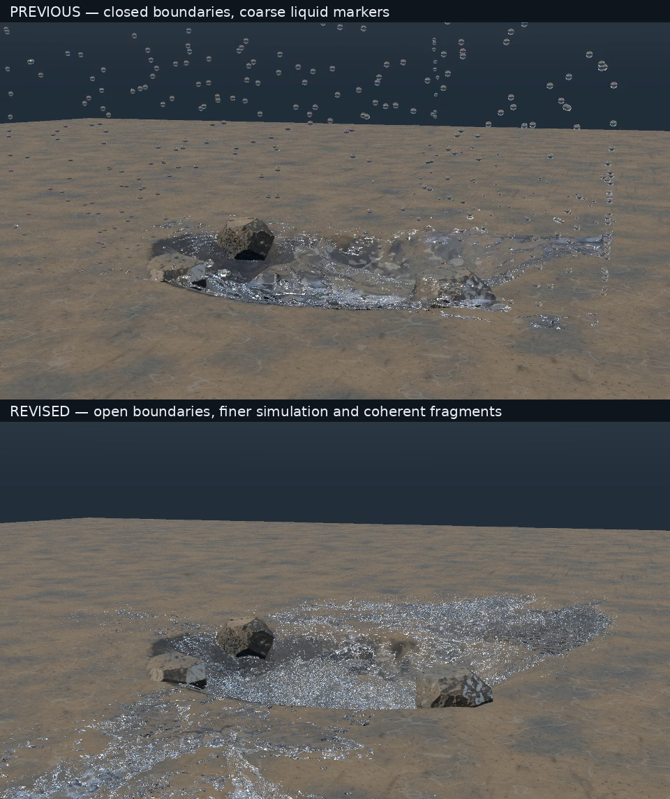

# Open-boundary splash repair

Latest source delivery, 22 October 2026: a native APIC/MAC waterbending shot with a finer simulation, open lateral boundaries, coherent-fragment reconstruction and flow-derived secondary visual parcels. This succeeds the [retained-trick revision](../retained-trick/README.md); the older closed-wall audit remains valid for that older source, not for this repaired take.



The [original movie](delivery/CYBR_WATERBENDING_OPEN_SPLASH_10S.mp4) is 960×540, 240 frames at 24 fps, ten seconds. The GIF is an actual 480×270, 12 fps reduction of that movie. It adds no motion interpolation. The imagery is native deterministic direct-light/Whitted preview rendering, **not converged global illumination**.



## What is repaired, and what is not

- The four lateral faces and top are open; the bottom face is closed. The bed and rocks remain actual collision and rendered geometry. The supplied 241-state audit has zero primary markers within two grid cells of a lateral exit, minimum recorded clearance 0.87882065773 m, and zero recorded primary outflow. Volume retention alone is not the wall test.
- Uniform grid spacing is 3 cm, with 1 cm primary marker spacing and 439,737 markers. Recorded represented volume remains 0.43973699889 m³. The older take used a 4.5 cm grid, 38,027 markers and about 0.433151 m³: this is a new simulation, not visual subdivision of the old cache.
- ID-tracked fragment hysteresis detaches beyond 3.2 marker spacings and rejoins below 2.2, rather than classifying every sparse connected ligament by the old neighbour-count rule. Reconstruction uses a 1.2 cm lattice, 3.2 cm support radius and three scalar smoothing passes.
- The finite-volume detached primary spheres now have approximately 12.407 mm equivalent diameter, rather than 27.916 mm. This remains a numerical sampling scale, **not a validated physical atomization spectrum** or microscopic spray model. Secondary spray/foam/bubble parcels are one-way visual samples, not conserved primary liquid or coupled air.
- Body-force guidance ends at 8.55 s. The final splash still has resolution-limited roughness and glints; the outward sweep is not a resolved whip tip. There is no adaptive hierarchy, sub-grid capillary breakup, fully coupled air or production-wide validation of all scenes.



## Explicit domain handoff at nine seconds

The initial domain is [-3.3, -0.12, -2.52] to [3.3, 3.3, 2.52] m. At frame 216 / 9 s, the saved state is transferred to [-6, -0.12, -5.1] to [4.02, 2.7, 7.5] m at the same grid spacing, keeping the final splash away from open exits.

Static comparison of the packaged before/after snapshots independently confirms byte-identical primary positions, velocities, volume sidecars and IDs, plus identical saved secondary kinematic payloads. **APIC affine gradients are reconstructed and pressure warm start is reset. This is not a bitwise checkpoint continuation or proof of full affine-energy conservation.** Secondary IDs are regenerated on import; the saved secondary format does not carry those IDs.

The full cache is not bundled. The final movie uses the preserved prefix and a recomputed expanded-domain suffix. The rejected smaller-domain outlet probe is not presented as successful footage. See [domain handoff](DOMAIN_HANDOFF.json), [historical conservation check](handoff_conservation_test.json), and the import implementation in [gallery_simulate.cpp](engine/src/gallery_simulate.cpp).

## Requirements and reproduction

Windows, Linux or macOS with CMake 3.30+, a C++17 compiler, FFmpeg/ffprobe, Python 3.10+, NumPy, pandas and Pillow. See [portable native setup](../README.md#portable-native-setup) for compiler/runtime choices and an explicit serial fallback. The native source uses the C++ standard library, without an external C++ or GPU dependency. Allow several GB of RAM and disk for the regenerated state cache and render intermediates. This is a substantial CPU job, not a real-time demo.

From the repository root:

Create an environment with `python -m venv .venv`. Use `.venv/bin/python` on Linux/macOS or `.venv/Scripts/python.exe` on Windows in place of `python` below:

```text
python -m pip install -r open-splash/requirements.txt
python open-splash/reproduce.py --output runs/open-splash --sim-threads 3 --render-threads 4
```

The output must be new or empty and outside `open-splash/`. The driver compiles the supplied native programs and tests, runs the supplied checks, exports matching solids/SDFs, simulates to frame 216, performs the domain transfer, finishes 241 states, reconstructs/renders frames 0–239, encodes the movie and verifies it. The driver copies the CMake definition and build helper with the engine, selects the local compiler, and resolves executable suffixes and OpenMP runtime paths. GNU Make is not required. Add `--checks-only` to build and run checks without a full simulation or film; this bounded path needs only the C++ toolchain, CMake and Python. `--openmp ON` requires parallel support, `--openmp OFF` selects serial execution, and the default `AUTO` reports the selected mode. An optional `--previous-video` argument supplies an older movie for its comparison sheet.

The recorded delivery used three simulation threads initially and two for its handoff suffix; the reproduction driver uses its chosen `--sim-threads` for both stages. [Build provenance](BUILD_PROVENANCE.json) records the original compiler and library versions. Compiler, CPU, thread count and floating-point differences can change trajectories and hashes. This repository does not promise universal bitwise reproduction.

The original publication review did not execute native code. Saved delivery test reports remain historical; the later portability workflow exercises native checks and a bounded real solver/surface/render path without claiming to reproduce the full movie.

## Original sample-state transport

Six original `.bin` snapshots are 14,071,616 bytes each. They are stored as deterministic, uncompressed 8 MiB byte parts so individual encoded uploads remain under 16 MiB. No snapshot data is dropped or resampled. The companion IDs, volumes and secondary states remain intact files. The [parts index](transport-parts.json) records every original and part size and SHA-256.

The following standard-library helper verifies all parts and concatenated originals, without running any simulation:

```sh
python3 open-splash/restore_transport_parts.py --check-only
python3 open-splash/restore_transport_parts.py
```

The second command restores the six original `.bin` filenames beside their parts, preserving exact bytes. It refuses to overwrite a different existing file. The restored binaries are ignored by Git; keep the committed parts. Restoration is needed to inspect the supplied native snapshots, but not to run `reproduce.py`, which creates a fresh simulation.

## Evidence and packaging

- [Verification v2](delivery/VERIFICATION.json), [full-movie decoded-frame hashes](delivery/DECODED_FRAMES.framemd5), and unchanged [original delivery notes](README_DELIVERY.md).
- [Retention](cache/retention.csv), [domain audit](cache/domain_audit.csv), [diagnostics](cache/diagnostics.csv), and [boundary conditions](cache/boundary_conditions.json), covering states 0–240.
- [All 240 frame records](evidence/frame_records.json), aggregated under original filenames. Recorded numeric values and hashes are unchanged; old machine-specific input-path prefixes are removed. The same prefix is removed from [historical handoff commands](handoff_commands.json).
- Original representative states at frames 0, 180, 216, 234 and 240, plus the exact pre-transfer frame 216. State 240 is the ten-second endpoint, not an extra video frame.
- Full engine and test sources, reproduction scripts, source patch, final fragment-classification state, and historical test reports. Simulation behavior, raw sample bytes, delivered images and MP4 bytes are preserved. Later portability edits add CMake/runtime support, required standard-library includes, and a precision fallback for platforms with Float64-only `long double`. Redundant delivery README, original archive inventory and process-ID job log are not public files.

Publication review independently checked archive-entry hashes, provided snapshot-to-record hashes, handoff primary bytes, recorded volume/boundary claims, JSON and Python syntax, local documentation links, and strict decoding of every video. All 240 frames of this movie decode uniquely. This verifies the supplied evidence, not the absent full cache or a fresh physics run. No project license was supplied; no license grant is added.
