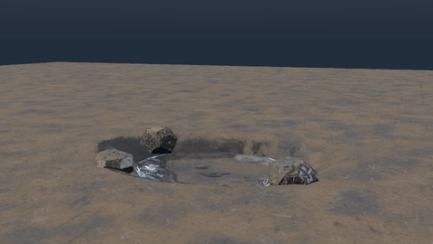
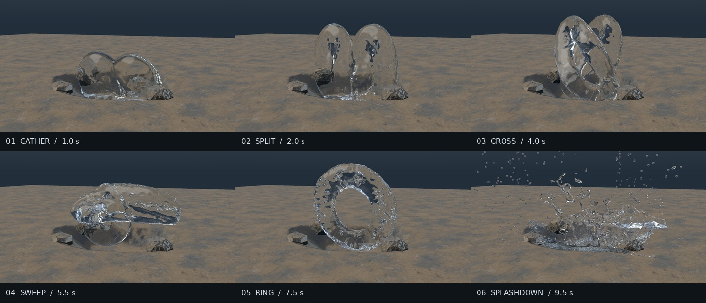
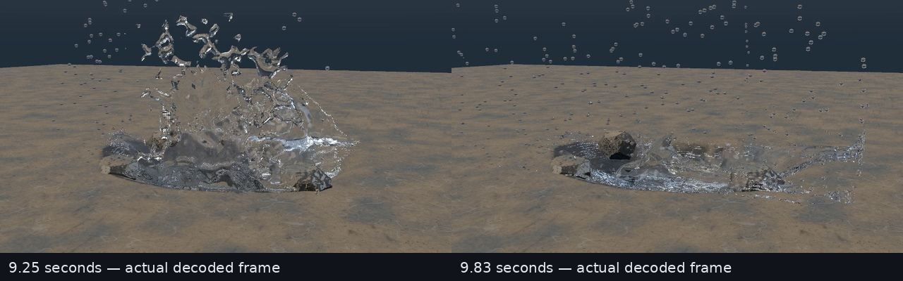

# Retained-trick waterbending study

Earlier packaged source, retained for lineage: native APIC/MAC velocity feedback with moving-guide feed-forward, applied before pressure projection. The closed guides morph through gather, split, crossing, outward sweep, ring, and release. They supply forces rather than rendered water geometry.

This revision completes a real native surface movie and retains the guided liquid forms more clearly than the preceding transport experiment. **This revision's later splash audit finds artificial boundary contact and repeated coarse-marker beads. Its historical simulation behavior/media remain intact; build and renderer portability repairs are documented in the root README. A subsequent [open-boundary repair](../open-splash/README.md) is packaged separately, with a new simulation and explicit 9 s domain handoff.**



[Full movie](../media/retained-trick-10s.mp4): 960×540, 240 frames at 24 fps, exactly 10 seconds. The GIF reduces this to 480 pixels wide and 12 fps without inventing intermediate motion.



## What changed

- The shared native engine now has bounded velocity feedback and moving-guide feed-forward on MAC faces before the incompressibility projection. The previous open-ended acceleration guide remains available as `legacy_trick`.
- The recorded take uses a uniform 4.5 cm grid, 2.25 cm marker spacing, 38,027 primary markers, and approximately 0.433151 m³ of represented water. Reseeding, inlets, and secondary whitewater are disabled. Guidance is zero at and after 8.55 seconds.
- The rendered surface is reconstructed from each solved state at a 1.8 cm lattice with five scalar-field smoothing passes and support of 3.6 marker spacings.
- Rendering uses the new deterministic direct-light/Whitted preview: four fixed subpixel samples, 12-bounce cap, native Fresnel/refraction/TIR and Beer attenuation. This is not converged Monte Carlo path-traced global illumination. The older integrator remains available without `--deterministic-preview`.

## Historical splashdown limitations in this revision



The later [SPLASH_AUDIT](SPLASH_AUDIT.md) is included unchanged. Its main findings were also checked against the supplied source and static data during packaging:

- The lateral and bottom numerical faces are closed; the top is open. The source clamps markers back inside closed faces and removes outward normal velocity. Those numerical side walls have no rendered containment box.
- Boundary proximity first appears in the sampled record at frame 215 (8.95833 s): 99 markers within 1 cm. The peak is 2,503 markers at frame 226 (9.41667 s). These are proximity counts, not exact collision-event counts.
- Every stored primary-marker volume at frame 228 is 1.13906253318e-05 m³. The mesher turns an isolated marker into a sphere with radius `cbrt(3 * volume / (4 * pi))`, giving a repeated diameter of about 2.79158 cm. This is a coarse marker-volume rendering choice, not a physically predicted spray-size spectrum.
- Thickened/perforated sheets and chunky rims are visible. Large kernel support and smoothing may contribute, but attributing their exact effect needs a same-state reconstruction comparison. A pressure/impact energy defect has not been established.

There is no adaptive refinement, resolved surface tension, coupled air, or physically modeled diffuse whitewater. The clean deterministic preview removes stochastic rendering grain; it does not validate the fluid physics. The audit proposes moving/modeling boundaries and validating sheet reconstruction and parcel sizes, but those changes have not been retroactively applied to this historical source. See the newer open-boundary revision for its own repair evidence and limitations.

## Requirements and reproduction

Windows, Linux or macOS with CMake 3.30+, a C++17 compiler, Python 3.10+ and FFmpeg. See [portable native setup](../README.md#portable-native-setup) for OpenMP and serial options. The two main Python runners use the standard library. Optional older diagnostic `drop33_containment.py` uses NumPy and expects its own capture data, which is not part of this take. No GPU or external C++ library is required by this source.

From the repository root:

```sh
cd retained-trick
python3 run_all.py --threads 4
```

This builds the complete engine through CMake, runs its solver, guidance and tracer checks, regenerates all 241 states, renders 240 native frames, and encodes the movie. Add `--checks-only` to stop after the native checks; `--openmp ON` requires parallel support and `--openmp OFF` selects serial execution. The full pipeline is a potentially long CPU workload. It overwrites the local cache and output movie and deliberately deletes existing `rendered/frame_*.png` and `.json` files before rerendering. Use a disposable working copy if you need to preserve an earlier run.

The saved movie is outside this directory at `../media/retained-trick-10s.mp4`, so the runner's newly generated movie will not overwrite the committed original preview. After a complete integration, render a selected existing state range with:

```sh
python3 render_sequence.py --start 0 --end 240 --threads 4
```

The end is exclusive. The package contains only seven selected cache states (0, 48, 96, 132, 180, 228, 240), not all 241, so the full render command needs a fresh integration first. The renderer skips already-present output PNG+JSON pairs. Clear those outputs deliberately when changing rendering settings; do not mistake old frames for a new render.

To build and run the supplied core checks separately:

```text
python ../tools/native.py build --revision retained-trick --build-dir CYBR_WATER_VFX/build
python ../tools/native.py test --build-dir CYBR_WATER_VFX/build
```

These commands run from `retained-trick/`. The guidance check is now included by CTest and `run_all.py`; the historical reports below remain records of the supplied take.

## Included evidence

- [VERIFICATION.json](VERIFICATION.json), including post-release boundary contact and rendering limitations. Its `video` field retains the original delivered movie basename; the publication copy is [here](../media/retained-trick-10s.mp4).
- [Original delivery notes](SOURCE_DELIVERY.md), preserved for the revision's context. The later splash audit qualifies its conclusions.
- [All 240 per-frame records](evidence/frame_records.json), combined into one JSON document under original filenames. Numerical data, source-state hashes, and PNG hashes are preserved; original machine-specific absolute render-input prefixes are removed.
- [Retention](production_cache/retention.csv), [numerical diagnostics](production_cache/diagnostics.csv), [domain audit](production_cache/domain_audit.csv), and [boundary conditions](production_cache/boundary_conditions.json).
- Seven original binary sample states with ID, volume and whitewater sidecars, plus static review mesh/SDF inputs. These are sample data, not a complete simulation cache.
- [Solver](solver_tests_final.json), [optics](optics_tests_final.json), and [guidance](guidance_tests_final.json) reports from the delivered run. These historical passes were not rerun for publication.
- [Native repair patch](native_repair.patch) and complete engine/test source. Later portability changes preserve the simulation equations and original optics assertions.

The archive name uses “FIXED” for the earlier transport repair. It does not mean the later splash defects are fixed. No new license grant is added.
